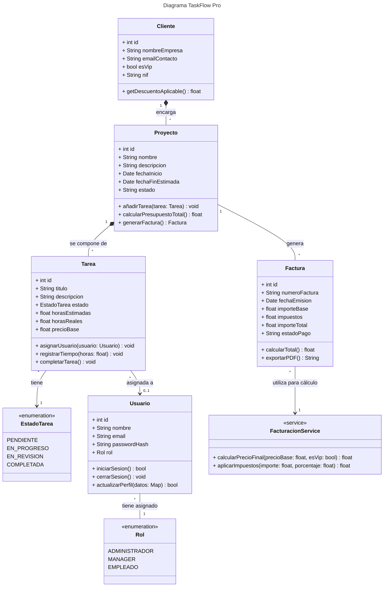

# Diseño del Sistema

A continuación se presenta el diagrama de clases completo de la plataforma TaskFlow Pro, modelando las entidades principales del dominio, sus atributos, métodos y las relaciones entre ellas. Se utiliza la sintaxis de Mermaid para su renderizado.

## Descripción de las Entidades

- **Usuario y Rol:** Define a los empleados del sistema y su nivel de acceso. Un usuario puede ser asignado a múltiples tareas.
- **Cliente:** Representa a las empresas o particulares que contratan los proyectos. Incluye el flag `esVip` que el servicio de facturación utiliza para aplicar descuentos.
- **Proyecto:** Agrupa múltiples tareas y pertenece a un único cliente. Es la entidad desde la cual se puede calcular un presupuesto global o emitir una factura.
- **Tarea:** La unidad mínima de trabajo. Registra estimaciones, horas reales invertidas y un precio base.
- **Factura y FacturacionService:** Manejan la lógica de negocio para calcular importes finales, aplicar reglas de descuentos, impuestos y emitir documentos en PDF.
