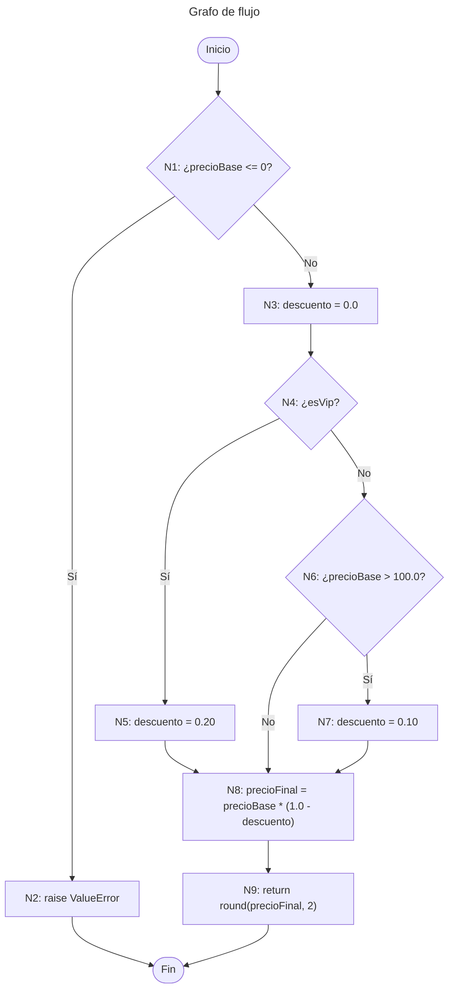

# Pruebas: Análisis de Caja Blanca

Para garantizar la calidad y robustez del código en **TaskFlow Pro**, aplicamos técnicas de diseño de pruebas de **caja blanca**, asegurando la cobertura de todos los caminos independientes del grafo de flujo de nuestra lógica de negocio.

## Análisis de la función `calcularPrecioFinal`

Evaluaremos la función principal del servicio de facturación ubicada en `app/services/FacturacionService.py`.

### Grafo de Flujo

A continuación, se representa el grafo de control de flujo de la función. Cada nodo representa una única sentencia o evaluación lógica, incluyendo los nodos explícitos de Inicio y Fin.



### Complejidad Ciclomática

Para determinar el número mínimo de casos de prueba necesarios para alcanzar una cobertura de caminos (Path Coverage) del 100%, calculamos la complejidad ciclomática $V(G)$:

- **$V(G) = P + 1$**, donde $P$ es el número de nodos predicado (decisiones lógicas simples).
- Nodos predicado en nuestra función:
  1. `N1: precioBase <= 0`
  2. `N4: esVip`
  3. `N6: precioBase > 100.0`
- $V(G) = 3 + 1 = 4$

Por tanto, necesitamos 4 casos de prueba para recorrer los 4 caminos lógicos independientes.

### Caminos Lógicos Independientes

Basándonos en la nueva estructura del grafo, definimos los 4 caminos:

- **Camino 1 (Inicio $\rightarrow$ N1 $\rightarrow$ N2 $\rightarrow$ Fin):** El precio base es menor o igual a 0. Lanza excepción y termina la ejecución.
- **Camino 2 (Inicio $\rightarrow$ N1 $\rightarrow$ N3 $\rightarrow$ N4 $\rightarrow$ N5 $\rightarrow$ N8 $\rightarrow$ N9 $\rightarrow$ Fin):** Precio válido y el cliente es VIP. Se aplica el 20% y se calcula/retorna.
- **Camino 3 (Inicio $\rightarrow$ N1 $\rightarrow$ N3 $\rightarrow$ N4 $\rightarrow$ N6 $\rightarrow$ N7 $\rightarrow$ N8 $\rightarrow$ N9 $\rightarrow$ Fin):** Precio válido, no es VIP, y el precio es mayor a 100.0. Se aplica el 10% y se calcula/retorna.
- **Camino 4 (Inicio $\rightarrow$ N1 $\rightarrow$ N3 $\rightarrow$ N4 $\rightarrow$ N6 $\rightarrow$ N8 $\rightarrow$ N9 $\rightarrow$ Fin):** Precio válido, no es VIP, y el precio es menor o igual a 100.0. Se calcula directamente sin aplicar descuento.

### Implementación de las Pruebas (Pytest)

A continuación, los casos de prueba diseñados (ubicados en `tests/unit/TestFacturacion.py`) que cubren el 100% de las ramas de la función:

```python
# tests/unit/TestFacturacion.py
import pytest
from app.services.FacturacionService import calcularPrecioFinal

def test_calcularPrecioFinal_c1_excepcion():
    """Camino 1 (N1 -> N2): Precio menor o igual a 0 debe lanzar ValueError"""
    with pytest.raises(ValueError, match="El precio base debe ser estrictamente positivo."):
        calcularPrecioFinal(0, False)

def test_calcularPrecioFinal_c2_vip():
    """Camino 2 (N4 -> N5): Cliente VIP aplica un 20% de descuento, independientemente del importe"""
    resultado = calcularPrecioFinal(50.0, True)
    assert resultado == 40.0  # 50 - 20%

def test_calcularPrecioFinal_c3_mayor_100():
    """Camino 3 (N6 -> N7): Cliente no VIP con compra > 100€ aplica un 10% de descuento"""
    resultado = calcularPrecioFinal(200.0, False)
    assert resultado == 180.0  # 200 - 10%

def test_calcularPrecioFinal_c4_normal():
    """Camino 4 (N6 -> N8): Cliente no VIP con compra <= 100€ no tiene descuento"""
    resultado = calcularPrecioFinal(99.50, False)
    assert resultado == 99.50  # Precio base intacto
```
